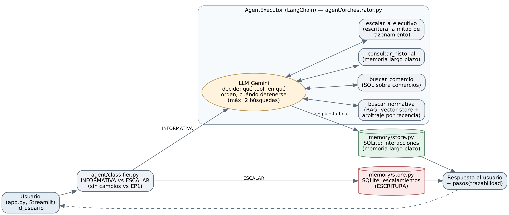

# Agente informativo BAES — Pluxee Chile

Agente basado en LLM y RAG que responde consultas normativas sobre el
beneficio BAES, y deriva a un ejecutivo humano las consultas transaccionales
o complejas.

## Requisitos
- Python 3.10+
- Una API key gratuita de Google AI Studio: https://aistudio.google.com/apikey

## Instalación
```bash
pip install -r requirements.txt
cp .env.example .env
# pega tu GOOGLE_API_KEY en .env
```

## Construir el índice (una sola vez)
```bash
python scripts/ingest_all.py
```
Esto también crea el archivo de memoria persistente (`data/processed/memoria.db`).

## Ejecutar
```bash
python -m streamlit run app.py --server.fileWatcherType none
```
Se abre automáticamente en el navegador, en `localhost:8501`. En la barra
lateral hay un campo "Tu identificador" — escribe el mismo valor en una
sesión nueva para que el agente pueda referenciar tus consultas anteriores
(memoria de largo plazo, ver `docs/arquitectura.md`).

## Verificar el agente (EP2)
Para reconfirmar el AgentExecutor de punta a punta (por ejemplo, tras cambiar
prompts o tools), corre un escenario real — consume cuota de Gemini, ver
limitaciones:
```bash
python scripts/check_agent_executor.py --escenario normativa
```
Ver el docstring del script para los otros 3 escenarios (`comercio`,
`escalamiento`, `memoria`).

**Nota:** se usa `python -m streamlit` en vez de `streamlit` directo porque en
algunos entornos (especialmente Windows) el ejecutable no queda en el PATH
del sistema pese a estar instalado. El flag `--server.fileWatcherType none`
evita que Streamlit escanee innecesariamente los submódulos de la librería
`transformers`, lo que sin el flag puede generar cientos de advertencias
inofensivas en la terminal y una carga inicial más lenta (pantalla en negro
por varios segundos antes de que aparezca la interfaz — no es un error).

## Observabilidad (EP3)
Cada respuesta del agente (desde `app.py` o desde la evaluación) queda
registrada en `data/processed/observabilidad.db`: latencia por etapa, tokens,
llamadas al LLM, los pasos del agente (herramienta, argumentos, duración,
éxito) y el tipo de error. Las consultas y respuestas se guardan con los datos
personales enmascarados y el identificador de usuario anonimizado. El
dashboard lee esa base y los archivos de `data/processed/eval/`.

**1. Generar datos.** Estos comandos se corren desde la raíz del proyecto:
```bash
# Recuperación (sin LLM, no gasta cuota): deja un CSV en data/processed/eval/
python scripts/evaluar_recuperacion.py
# ...e imprime los fragmentos recuperados de cada consulta sin acierto
python scripts/evaluar_recuperacion.py --detalle

# Agente (llama a Gemini): una corrida acotada, gastando la cuota en orden de prioridad
python scripts/evaluar_agente.py --solo-principal --orden --repeticiones 1
# Todas las preguntas con 3 repeticiones (varios días con el nivel gratuito; es reanudable)
python scripts/evaluar_agente.py --orden --repeticiones 3

# Métricas: imprime el resumen y guarda data/processed/eval/metricas.json
python scripts/calcular_metricas.py
```
`evaluar_agente.py` consume cuota de Gemini (unas 3-4 solicitudes por ejecución
y alrededor de 20 por día en el nivel gratuito): se detiene solo tras 3
respuestas 429 seguidas y, al volver a correrlo, retoma lo que faltaba. Imprime
el modelo activo al empezar. `calcular_metricas.py` y `evaluar_recuperacion.py`
no llaman a Gemini.

**2. Etiquetas del estudiante.** La primera vez, `calcular_metricas.py` crea la
plantilla `data/processed/eval/etiquetas.csv` con una fila por respuesta: llena
la columna `correcto` (`1`, `0` o `parcial`) y vuelve a correrlo. En las
corridas siguientes agrega al final las ejecuciones nuevas, sin tocar lo ya
etiquetado, e informa cuántas agregó. Si lo editas con Excel, guárdalo como
CSV UTF-8 y ciérralo antes de volver a correr el script. Sin etiquetas, el
dashboard avisa que faltan y deja vacía la precisión de veredicto.

**3. Abrir el dashboard.**
```bash
python -m streamlit run dashboard.py --server.fileWatcherType none
```
Muestra indicadores, latencia (p50 y p95 por etapa y por herramienta), errores
por tipo y por fecha, calidad por categoría de caso, la recuperación estricta
vs. ampliada del último CSV y un explorador de trazas. Los filtros de la barra
lateral (fecha, origen, modelo, estado y tipo de error) indican siempre cuántas
ejecuciones quedan. Solo lee: si la base no existe o está vacía, lo avisa y no
la crea.

**4. Purgar los registros.** Borra las ejecuciones (y sus pasos) con más de N
días; por defecto, 30:
```bash
python scripts/purgar_observabilidad.py --dias 30
```

**5. Pruebas.** No usan Gemini ni escriben en las bases reales (memoria y
observabilidad):
```bash
python -m pytest tests/
```

## Estructura
- `agent/` — clasificador, generador (EP1), orquestador (EP2:
  `AgentExecutor`), tools del agente (EP2: `tools.py`), escalamiento (EP1,
  superado por `memory/store.py` en EP2, ver su docstring)
- `rag/` — carga de fuentes, chunking, embeddings, retrieval, arbitraje
- `memory/` — **EP2**: persistencia SQLite — escalamientos (escritura) y
  memoria de largo plazo (`interacciones`)
- `llm/` — wrapper del proveedor LLM (Gemini, nivel gratuito), usado por el
  clasificador
- `prompts/` — `clasificador.py` y `generador.py` (EP1), `agente.py` (EP2:
  system prompt del `AgentExecutor`)
- `data/` — fuentes (manual BAES real, FAQ, comercios simulados, social mock)
- `observabilidad/` — **EP3**: registro de ejecuciones (SQLite), métricas,
  casos y evaluación de recuperación, y la lógica de datos del dashboard
- `eval/casos.json` — **EP3**: casos de evaluación (preguntas, variantes,
  respuesta esperada)
- `dashboard.py` — **EP3**: dashboard de observabilidad (Streamlit)
- `scripts/` — verificaciones, ingesta y los scripts de evaluación y métricas
- `docs/arquitectura.md` — decisiones de diseño y limitaciones con evidencia,
  EP1 y EP2

## Arquitectura — diagrama de orquestación (EP2)



El clasificador (misma lógica de EP1; su prompt se amplió en EP2 para no bloquear la memoria de largo plazo) decide INFORMATIVA vs ESCALAR. Si ESCALAR, se
registra la derivación directo en SQLite (escritura). Si INFORMATIVA, se arma un
`AgentExecutor` de LangChain con 4 tools (`buscar_normativa`, `buscar_comercio`,
`consultar_historial`, `escalar_a_ejecutivo`); el LLM decide qué tool invocar, en qué orden y
cuándo detenerse. Toda interacción resuelta se registra en la memoria de largo plazo antes de
responder. Detalle completo en `docs/arquitectura.md`.

## Limitaciones conocidas
- Nivel gratuito de Gemini: 5 solicitudes/min, 20/día — evitar ráfagas de
  preguntas seguidas. Si aparece un error `429 RESOURCE_EXHAUSTED`, es la
  cuota diaria agotada, no una falla del sistema; probar con una API key
  propia resuelve esto de inmediato.
- El umbral de arbitraje por similitud (0.9) prioriza evitar falsos positivos
  sobre detectar todas las contradicciones reales entre fuentes.
- El listado de comercios es un dataset simulado (Pluxee no publica uno
  descargable).
- El identificador de usuario de la memoria de largo plazo (barra lateral)
  no es autenticación real — cualquiera que lo escriba puede ver ese
  historial. Ver `docs/arquitectura.md`.
- Los 4 escenarios de `scripts/check_agent_executor.py` (normativa, comercio,
  escalamiento, memoria) se verificaron con Gemini real; detalle en
  `docs/arquitectura.md`.

## Uso de IA
Se usó Claude para apoyo en redacción de código, diagramas y documentación
técnica. Decisiones de diseño e interpretación de resultados son propias.
